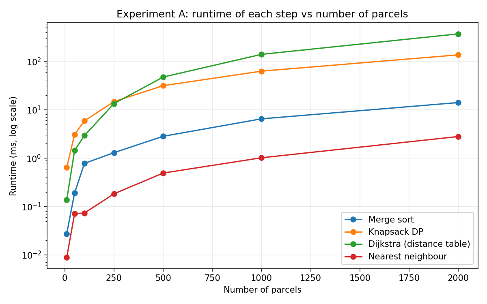
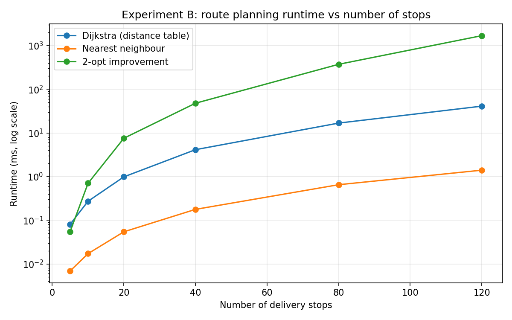

# Intelligent Courier Planning System: Final Report

**Name:** Nisha Kumari  **Roll no.:** 2501060036  **Course / Lab:** Design and Analysis of Algorithms

> Runtimes below were measured on the author's own computer (best of 3 runs,
> fixed random seeds). Timings differ between computers; route lengths do not.

## 1. Introduction
This project is a prototype courier planning system. Given parcels and delivery
points, it decides which parcels go on each van trip (packing plan) and in what
order to visit the delivery points (route). It combines the four algorithm
families from the labs: **sorting, dynamic programming, graph algorithms and
approximation**. The full design is in `docs/DESIGN.md`.

## 2. Design summary (Phase 1)
- Parcels: `id, weight (kg, integer), value, priority (1-3), destination`.
- Delivery points and roads form a weighted, undirected graph stored as an adjacency list.
- Pipeline: merge sort -> knapsack DP -> Dijkstra -> nearest neighbour + 2-opt, repeated trip by trip.

## 3. Package prioritization and box filling (Phase 2)

**Sorting.** Parcels are sorted with merge sort by priority (high to low), then by value.
It is O(n log n) in every case and stable.

**Knapsack DP.** `dp[i][c]` = best value using the first `i` parcels with capacity `c`.
Sample input: 8 parcels, van capacity 15 kg. Last rows of the DP table
(full table: `data/sample_output.txt`, run `python main.py --show-dp`):

```
                0    1    2    3    4    5    6    7    8    9   10   11   12   13   14   15
P3 (w=6)        0    0    0   30   50   60   70   90   90  110  120  140  150  160  170  180
P8 (w=4)        0    0    0   30   50   60   70   90   95  110  120  140  150  160  170  185
P6 (w=2)        0    0   20   30   50   60   70   90   95  110  120  140  150  160  170  185
```

Best value for capacity 15 is **185**. Backtracking the table selects
**P5 (7 kg), P2 (4 kg), P8 (4 kg)** = 15/15 kg. The remaining parcels are packed
into trips 2 and 3 the same way.

| Trip | Parcels | Load | Value |
|---|---|---|---|
| 1 | P5, P2, P8 | 15/15 kg | 185 |
| 2 | P1, P4, P3 | 14/15 kg | 160 |
| 3 | P7, P6 | 10/15 kg | 100 |

## 4. Route maker and graph processing (Phase 3)
Roads of the sample network (km): Depot-A 4, Depot-B 7, Depot-C 10, A-B 3, A-D 6,
B-C 4, B-E 8, C-F 5, D-E 4, E-F 6.

Dijkstra computes shortest distances between the depot and every stop of the trip.
Nearest neighbour then orders the stops, and 2-opt tries to shorten the order.

| Trip | Delivery order | Road path | Distance |
|---|---|---|---|
| 1 | Depot -> B -> C -> E -> Depot | Depot-B-C-F-E-D-A-Depot | 36 km |
| 2 | Depot -> A -> D -> C -> Depot | Depot-A-D-A-B-C-Depot | 33 km |
| 3 | Depot -> A -> F -> Depot | Depot-A-B-C-F-C-Depot | 31 km |

Total: 3 trips, **100 km**. (Road paths may pass through other nodes, e.g.
trip 3 reaches F through B and C, because that is the shortest road path.)

## 5. Performance testing and optimization (Phase 4)

### 5.1 Correctness evidence (`python tests/test_correctness.py`)
| Check | Result |
|---|---|
| Merge sort vs Python `sorted()`, 200 random lists, plus stability | pass |
| Knapsack DP vs brute force (all subsets), 200 random cases | pass |
| Dijkstra vs Bellman-Ford, 100 random graphs | pass |
| Routes are valid round trips; 2-opt never longer than nearest neighbour | pass |
| Route length vs brute-force optimum (60 cases, 3-7 stops) | nearest neighbour up to 1.24x optimal, with 2-opt up to 1.04x |

### 5.2 Experiment A: whole pipeline vs number of parcels (capacity 200 kg)

| Parcels | Stops in trip | Sort (ms) | Knapsack (ms) | Dijkstra (ms) | Nearest neighbour (ms) |
|---|---|---|---|---|---|
| 10 | 6 | 0.027 | 0.645 | 0.138 | 0.009 |
| 50 | 16 | 0.191 | 3.099 | 1.444 | 0.071 |
| 100 | 25 | 0.780 | 5.904 | 2.930 | 0.073 |
| 250 | 41 | 1.299 | 14.752 | 13.404 | 0.183 |
| 500 | 69 | 2.829 | 31.452 | 47.408 | 0.492 |
| 1000 | 96 | 6.498 | 62.822 | 139.696 | 1.019 |
| 2000 | 120 | 14.093 | 136.365 | 370.079 | 2.799 |



### 5.3 Experiment B: route planning vs number of stops

| Stops | Dijkstra (ms) | Nearest neighbour (ms) | 2-opt (ms) | NN length (km) | 2-opt length (km) | Shorter by |
|---|---|---|---|---|---|---|
| 5 | 0.081 | 0.007 | 0.055 | 20 | 20 | 0.0% |
| 10 | 0.273 | 0.017 | 0.704 | 87 | 83 | 4.6% |
| 20 | 0.987 | 0.054 | 7.557 | 183 | 159 | 13.1% |
| 40 | 4.136 | 0.178 | 47.938 | 249 | 233 | 6.4% |
| 80 | 16.819 | 0.652 | 373.533 | 624 | 532 | 14.7% |
| 120 | 41.113 | 1.403 | 1693.179 | 800 | 719 | 10.1% |



### 5.4 Observations
- **Merge sort** grew from 0.027 ms to 14.1 ms for 200x more parcels (about 510x).
  That is more than linear and in line with n log n growth (about 660x expected;
  fixed overhead makes small inputs relatively slower).
- **Knapsack DP** grew roughly in step with the number of parcels (200x more
  parcels, about 210x more time) because capacity was fixed: O(n * capacity).
  Doubling the van capacity would roughly double its time as well.
- **Dijkstra** became the most expensive step in the pipeline for large inputs
  (370 ms at 2000 parcels). With more parcels, a trip has more distinct stops
  (6 -> 120) **and** the road network is larger, so one Dijkstra run per stop adds up.
- **Nearest neighbour** is almost free (2.8 ms for 120 stops).
- **2-opt** is the slowest step: 1693 ms for 120 stops, over 1000x the nearest
  neighbour time. Doubling stops from 40 to 80 multiplied its time by about 8
  (47.9 ms to 373.5 ms), which matches the O(k^3) cost per pass of this
  implementation. In exchange it shortened the route by 4-15% in these runs
  (the gain varies from case to case).

### 5.5 Optimization suggestions
1. **2-opt with delta evaluation.** The current code recomputes the whole route
   length for every candidate (O(k) each). Computing only the change from the 4
   edges involved makes each pass O(k^2) instead of O(k^3). This is the biggest
   speed-up available.
2. **Reuse Dijkstra results across trips.** The distance table is rebuilt for
   every trip. Computing shortest distances once per location and caching them
   removes repeated work when there are many trips.
3. **Stop Dijkstra early** once all required stops have been reached, instead of
   exploring the whole graph.
4. **Knapsack memory.** If only the best value is needed, a 1-D array reduces
   space from O(n * capacity) to O(capacity). Choosing the parcels still needs
   the table (or a record of choices).
5. **Better planning across trips.** Packing is greedy per trip, so trips may be
   spread over far-apart areas. Grouping parcels by delivery zone before packing
   would shorten routes.
6. **Stronger approximation.** Nearest neighbour has no fixed worst-case
   guarantee. An MST-based 2-approximation gives a proven bound, and Or-opt moves
   can improve routes further.

## 6. Limitations
- Weights must be integers (needed for the DP table).
- Routes are approximate, not guaranteed shortest (measured up to 1.24x optimal
  for nearest neighbour and 1.04x with 2-opt on small cases only; larger cases
  were not compared with the true optimum).
- Trips are planned greedily and the number of trips is not guaranteed minimal.
- Timings come from one machine and one random seed per experiment.

## 7. Conclusion
The system combines sorting, dynamic programming, shortest paths and
approximation into a working courier planner. Tests show each algorithm is
correct on small inputs, and the runtime experiments match the expected
complexities. The main scaling bottlenecks are Dijkstra (large inputs) and
2-opt (many stops), and Section 5.5 lists how to reduce them.

## 8. How to run
```
python main.py --show-dp          # planner with DP table
python tests/test_correctness.py  # correctness evidence
python benchmark.py               # runtime tables and charts (needs: pip install matplotlib)
```

## 9. Screenshots (output evidence)

**Figure 1.** Planner output: input, sorted parcels and the DP table (`python main.py --show-dp`).


**Figure 2.** Planner output: packing plan, route and distance for each trip.


**Figure 3.** Correctness tests (`python tests/test_correctness.py`).


**Figure 4.** Benchmark, Experiment A: pipeline runtime vs number of parcels (`python benchmark.py`).


**Figure 5.** Benchmark, Experiment B: route planning vs number of stops.


